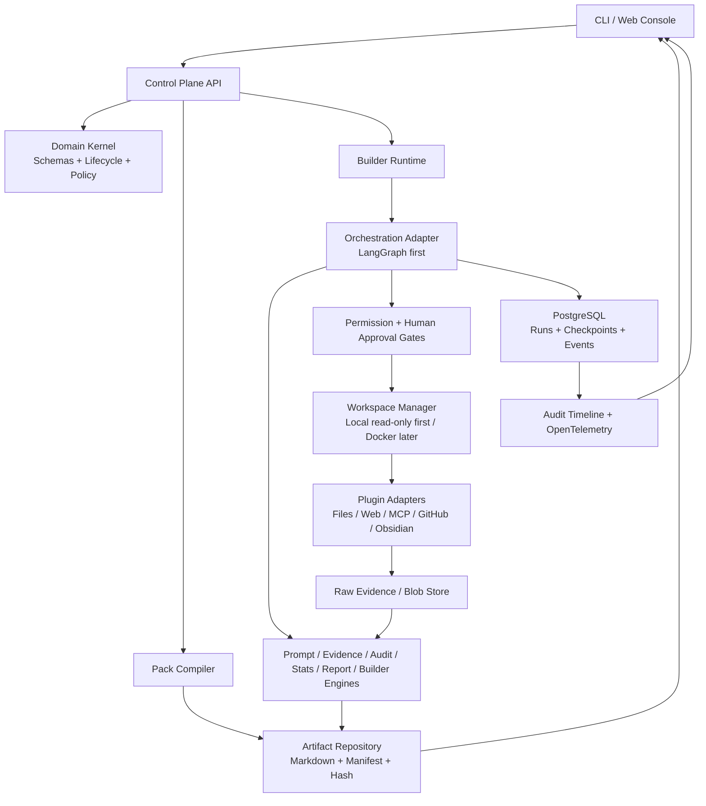

# Research-OS 技术实现方案

**Status:** Proposed / Non-normative
**Version:** 0.2.0-draft
**Date:** 2026-08-05
**Last Updated:** 2026-08-05 — narrowed Phase 1 to only `11-Runtime` after Validation 04
**Foundation Baseline:** `1.0.0-rc.1`
**Scope:** Foundation RC 之后的平台实现、首个 Builder Pack 与 APES 试点

> 本文是技术选型与实施路线，不修改 Foundation Constitution、Standards、FD
> 或 Release Manifest。任何新的 Foundation 实现目录、生产依赖、Project
> 实例或 APES 迁移，仍须通过适用的 FRFC / FD / PRFC / PD 和人工 Review。

## 1. 结论摘要

Research-OS 已按本方案完成公开仓库门禁与首个 GitHub Pre-release，并明确标注
为 **docs-first Foundation RC**，不是已经可运行的 AI 平台。当前工作转入实现
治理；Validation 04 的最小建议只支持 `11-Runtime`，尚未授权任何代码。

实现上采用“可验证工件优先的模块化单体”，而不是立即建设完整多租户平台：

1. Markdown + YAML Front Matter 继续作为人类可审阅的治理工件源。
2. Python Domain Kernel 将 Foundation Schema 映射为强类型对象和状态机。
3. Pack Compiler 验证并封装 Mission / Program / Task / Deliverable / Evidence。
4. Runtime 通过可替换的编排适配器执行 Pack；首选 LangGraph，但不让
   LangGraph 类型泄漏到 Foundation 工件。
5. 所有外部动作经 Workspace、Permission Gate 和 Human Approval Gate。
6. 首个产品能力是“有出处、可恢复、可审核的研究流水线”，而不是通用聊天。
7. APES 仅作为第一个 Project 试点；在找到真实源仓库并完成 FD 级激活前，
   不生成虚构业务工件。

## 2. 公开还是私有

### 2.1 建议

建议创建 **Public** 仓库 `longyuanai/Research-OS`。

理由：

- 当前资产主要是平台治理、规范、审计与发布证据，公开可提升可信度和可复核性。
- Repository 中没有客户数据、API Key、私钥或 APES 业务源代码；本机
  `.claude/` 已被 `.gitignore` 排除。
- Builder Pack、证据链、人工审批边界等差异化能力需要真实使用者反馈，公开比
  闭门扩展 Foundation 更符合“少搭系统，多做作品”。
- 公开 RC 能建立不可变基线，后续实现可以通过 Issue、RFC 和可复现 Demo 演进。

不建议立即公开的情形：APES 含未授权数据、计划将客户材料直接迁入同一仓库、
或许可证尚未确定。遇到这些情况，应将平台公开、Project 数据留在私有仓库，
通过 Pack Manifest 引用而非复制敏感内容。

### 2.2 公开前必须完成的门禁

| Gate | 要求 | 当前状态 |
|---|---|---|
| License | 代码与文档统一采用 Apache-2.0 | 已选择并添加标准许可证文本；不采用文档双许可证 |
| Root README | 说明 docs-first RC、能力边界、目录入口、路线图和非生产状态 | 已创建；发布前本地链接复核通过 |
| Security | 漏洞报告渠道、凭据与 Project 数据处理规则 | 已创建；Private Vulnerability Reporting、Secret Scanning、Push Protection 与 Dependabot 已启用 |
| Contributing | RFC/FD/PRFC/PD 路径、Review 与 DCO/CLA 选择 | 已创建；首阶段不采用 CLA/DCO |
| Secret/Privacy | 强密钥扫描、路径/用户名/客户数据扫描 | 发布前终检通过；公开可达 Git 历史使用 noreply；0 强密钥/个人路径/邮箱命中 |
| Release Integrity | `main`、`v1.0.0-rc.1`、Release Notes、Manifest 状态一致 | Public 仓库与 docs-first Pre-release 已验证；tag `139d455`，发布时 main `4c2f32d` |
| Branch Protection | PR Review、必需检查、禁止强推 tag | `main` 禁止强推/删除并要求线性历史；`v*` 禁止删除/非快进更新；审批与 required checks 待独立 Reviewer/CI 就绪后启用 |

## 3. GitHub 同类项目调研

调研时间为 2026-08-05。只使用项目官方 GitHub README、架构文档、目录、
语言统计和依赖清单；Star 数仅用于筛选，不作为架构质量结论。

### 3.1 对比总表

| 项目 | 主要功能 | 架构 | 主要技术栈 | 优点 | 局限 |
|---|---|---|---|---|---|
| [OpenHands](https://github.com/OpenHands/OpenHands) | 多编码代理控制台、会话、终端、文件、自动化、多后端 | Agent Canvas 通过 REST 连接一个或多个 Agent Server；可选 Automation Server；本机、Docker、VM、云均可运行 | TypeScript、React、React Router、Vite、Zustand、TanStack Query、Electron、Docker；后端 Agent Server 独立 | UI 与执行器边界清晰；多后端；明确警告宿主机权限；适合借鉴 Workspace/Sandbox | 编码代理导向；直接主机模式风险高；核心后端跨仓库；缺少 Research-OS 的治理与证据工件 |
| [LangGraph](https://github.com/langchain-ai/langgraph) | 长时、有状态代理编排，持久执行、Interrupt、Memory | Pregel 风格状态图；Checkpoint 抽象；SQLite/PostgreSQL 扩展；Python/JS SDK | Python 3.10+、Pydantic、langchain-core、独立 checkpoint/prebuilt/sdk 包 | Durable Execution、Human-in-the-loop、恢复语义与 Research-OS Runtime 高度匹配 | 是低层库而非完整产品；治理、证据、权限和 UI 需自建；应隔离生态耦合 |
| [Dify](https://github.com/langgenius/dify) | 可视化工作流、RAG、Agent、模型管理、LLMOps、API | Next.js Web + Flask API + Celery Worker + PostgreSQL/Redis + Sandbox/Plugin Daemon + 可选向量库 | TypeScript/Next.js、Python/Flask/Celery、PostgreSQL、Redis、Docker Compose、React Flow | 功能完整、模型与向量库生态广、可视化体验成熟、部署路径清晰 | 服务和依赖很多，早期复制会过度建设；许可证含 Apache-2.0 之外附加条件；工件治理不是核心 |
| [Khoj](https://github.com/khoj-ai/khoj) | 私有知识库、文档/网页问答、自定义 Agent、自动研究、跨端入口 | Django/FastAPI 服务、PostgreSQL+pgvector、SearXNG、Sandbox/Computer 服务、Web/编辑器集成 | Python、TypeScript、Django、FastAPI、pgvector、sentence-transformers、Docker | 个人知识工作台和本地优先体验强；Obsidian/文档接入值得借鉴 | AGPL-3.0 影响代码复用；个人助手模型与 Pack 生命周期不一致；完整部署仍有多服务成本 |
| [GPT Researcher](https://github.com/assafelovic/gpt-researcher) | Web/本地资料深度研究、并行检索、引用报告、MCP、导出 | Planner 生成问题，Execution Agents 并行搜集与摘要，Publisher 聚合报告；支持递归研究树 | Python 3.11+、FastAPI、LangChain/LangGraph、Pydantic、SQLAlchemy、Next.js、Docker | 与 Research-OS Evidence/Report 最接近；来源跟踪、并发和研究分解可直接借鉴 | 质量受搜索源和模型影响；插件/密钥面较大；默认缺少强人工审批与不可变审计链 |
| [Agent Laboratory](https://github.com/SamuelSchmidgall/AgentLaboratory) | 文献综述、实验、论文写作、科研角色协作、Copilot 模式 | 三阶段科研工作流；Professor/Postdoc/ML Engineer/PhD 等角色；YAML 配置和本地 checkpoint | Python 3.12、OpenAI/Anthropic、arXiv、Hugging Face、PyTorch、科学计算栈、LaTeX | 科研阶段清晰；保留人类研究者；实验和报告衔接好；适合 APES 试点 | 更像研究原型；依赖庞大且固定；配置示例将 API Key 放入 YAML 的模式不应照搬；隔离与审计较弱 |

### 3.2 可采用的设计

- 从 OpenHands 采用：UI/Agent Server 分离、多后端注册、Docker Workspace、
  终端/文件/事件时间线，以及“无 Sandbox 即高风险”的显式提示。
- 从 LangGraph 采用：状态图、Checkpoint、Interrupt、恢复与幂等语义。
- 从 Dify 采用：工作流可视化、Provider/Tool Registry、运行日志和 Docker
  Compose 开发体验；不采用其首版服务数量。
- 从 Khoj 采用：本地文档、Markdown/Obsidian 接入、PostgreSQL+pgvector 和
  隐私优先部署；不复制 AGPL 代码。
- 从 GPT Researcher 采用：Planner → Research Workers → Evidence Normalizer →
  Publisher 的研究管线，以及引用覆盖检查。
- 从 Agent Laboratory 采用：Literature Review → Experiment → Report 三阶段
  模板、Copilot 模式和 checkpoint；不采用将密钥写入任务 YAML 的方式。

### 3.3 明确不采用

- 不在 MVP 建设 Dify 级多租户、模型市场、几十种向量库和完整 LLMOps。
- 不允许 Agent 直接持有长期 API Key；凭据由独立 Secret Provider 注入。
- 不把 LangGraph、LangChain 或某一家模型供应商写入 Foundation 规范。
- 不让 Agent 自行批准 Pack、Review、发布、删除、推送或 APES 迁移。
- 不把聊天历史当审计日志；审计事件必须结构化、可哈希、可重放。

## 4. 目标产品定义

Research-OS 的首个可运行作品是：

> 读取一个经过验证的 Builder Pack，在受控 Workspace 内执行研究 Mission，
> 对每个来源、状态转换、工具调用和人工批准生成可追溯证据，最终输出可复核的
> Deliverable、Audit、Review 请求和 Report。

### 4.1 MVP 用户故事

1. 用户通过 CLI 选择一个 Draft Builder Pack。
2. 系统验证目录、Front Matter、引用、版本、Hash 和权限声明。
3. 用户预览 Mission、预计模型/工具、成本上限、可写路径和停止条件。
4. 人工批准后，Runtime 创建 Run 和 Checkpoint。
5. Planner 将 Mission 展开为有界 Tasks；不修改已批准 Pack。
6. Research Workers 只通过已授权 Plugin 获取资料。
7. Evidence Engine 保存来源、时间、方法、摘要、内容 Hash 和限制。
8. Report Engine 生成带引用的 Deliverable；Audit Engine 运行 Quality Gates。
9. Runtime 在 Review Gate 停止，由人类批准、要求修订或拒绝。
10. 系统封存 Run Manifest，支持从任一 Checkpoint 只读回放。

### 4.2 MVP 不包含

- 多租户、计费、组织权限、插件市场。
- 自主代码执行、浏览器登录、外部发布或 Git Push。
- 无人工门禁的长时间自治。
- APES Sprint 4 的真实执行。
- Stable `1.0.0` 声明。

## 5. 目标架构



### 5.1 平面分离

| 平面 | 职责 | 禁止事项 |
|---|---|---|
| Governance Plane | Constitution、Standards、FD/RFC/Review | 不执行任务 |
| Artifact Plane | Pack、Manifest、Evidence、Report、Hash | 不调用模型或工具 |
| Control Plane | Run 创建、调度、审批、预算、状态转换 | 不直接读写宿主机 |
| Execution Plane | Workspace 中的模型/工具执行 | 不批准自身结果 |
| Observation Plane | Event、Trace、Cost、Audit、Replay | 不改变运行状态 |

### 5.2 Domain Kernel

Domain Kernel 是唯一解释 Foundation Artifact 的模块，包含：

- Pydantic v2 Schema：Pack、Mission、Program、Task、Deliverable、Evidence、
  Manifest、Audit、Review、Report。
- Lifecycle State Machine：显式允许的转换与转换前置条件。
- Policy Evaluator：权限、预算、文件范围、网络范围、人工门禁。
- Reference Resolver：路径、ID、版本和依赖图。
- Integrity Service：SHA-256、Manifest sealing、canonical serialization。

Kernel 不依赖 LangGraph、FastAPI、数据库驱动或模型 SDK；这些通过端口接入。

### 5.3 Pack Compiler

Pack 的实现 Profile 建议使用 Markdown 正文 + YAML Front Matter：

1. 读取 Pack 目录但不执行内容。
2. 按 Foundation Schema 转换为强类型 IR。
3. 验证必需字段、引用、状态、版本、权限与停止条件。
4. 生成 canonical JSON 仅作为机器中间表示，不替代 Markdown 源工件。
5. 计算每个文件和 Pack 聚合 Hash。
6. 输出验证报告；存在错误时禁止进入 Runtime。

该序列化选择属于可替换的 Implementation Profile，不修改技术中立的 Pack
Standard；正式采用前须经 FRFC/FD。

### 5.4 Runtime 与编排

Runtime 保持自己的 `RuntimePort`，首个适配器使用 LangGraph：

- Foundation Task 映射为 Graph Node，但工件中不保存 LangGraph 类型。
- Foundation Review Gate 映射为 `interrupt`。
- Run/Task 状态写入 PostgreSQL Checkpoint。
- Side-effect 使用 idempotency key：`run_id + task_id + attempt + action_hash`。
- 恢复时从最后成功 Checkpoint 继续，不重复已确认外部动作。
- 每个 Node 都产出结构化 Event 和 Artifact delta。

### 5.5 Evidence-first 研究管线

借鉴 GPT Researcher，但增加 Foundation 约束：

```text
Research Question
  → Bounded Plan
  → Parallel Retrieval
  → Source Snapshot
  → Evidence Normalization
  → Claim-Evidence Mapping
  → Synthesis
  → Citation Gate
  → Audit
  → Human Review
```

每条 Claim 必须引用 Evidence ID；Evidence 至少包含 source URL/path、
collected-at、collector、method、content hash、摘要和限制。无法保留来源或授权
不明确的材料只可作为临时上下文，不可进入 Approved Deliverable。

### 5.6 Workspace 与安全边界

- MVP 默认只读挂载输入目录，只允许写入独立 Run 输出目录。
- Phase 2 引入 Docker Workspace；网络、CPU、内存、时间和进程数均设上限。
- Tool/Plugin 权限默认拒绝；按 Pack 声明逐项授权。
- Secret 通过环境注入或 OS/服务端 Secret Store 提供，不写入 Pack、Event、日志。
- 写文件、执行命令、外网访问、Git 操作、发布和删除分别设置独立审批策略。
- 检索到的网页/文档均视为不可信输入，防御 Prompt Injection 和数据外传。

## 6. 技术栈决定

| 层 | MVP 选择 | 原因 | 延后/替代 |
|---|---|---|---|
| Runtime Language | Python 3.12 | 科研、LLM、数据和验证生态最好 | Rust 仅用于未来高隔离执行器 |
| Package Manager | `uv` | 快、锁文件明确、适合 workspace | 不同时维护 Poetry/pipenv |
| API | FastAPI + Pydantic v2 | 强类型、OpenAPI、异步友好 | 不在 MVP 混用 Flask/Django |
| Domain Persistence | SQLAlchemy 2 + Alembic | 明确 Unit of Work 与迁移 | Kernel 通过 Repository Port 隔离 |
| State/Vector | PostgreSQL 16 + pgvector | 一套数据库覆盖事务、checkpoint、基础向量检索 | 小型开发可用 SQLite；其他向量库延后 |
| Orchestration | LangGraph Adapter | durable execution、interrupt、checkpoint | 保留自研/Temporal adapter 接口 |
| Background Jobs | MVP 单 Worker + PostgreSQL Job 表 | 最少服务且可恢复 | 并发需求证明后再加 Celery + Redis |
| Blob Store | 本地 content-addressed store | 简单、可哈希、可备份 | 部署后换 S3/MinIO adapter |
| CLI | Typer + Rich | 最快形成可演示作品 | CLI 先于 Web |
| Web | Next.js + TypeScript + Tailwind + TanStack Query | 易做审批箱、时间线、证据浏览 | React Flow 只在图形编辑确有需求时引入 |
| Streaming | SSE | 单向运行事件足够、比 WebSocket 简单 | 协同编辑时再用 WebSocket |
| Plugins | 内部 ToolPort + MCP Adapter | 支持标准工具生态且不绑死 MCP | 首批仅 Files/Web；GitHub/Obsidian 后加 |
| Observability | JSON Event Log + OpenTelemetry | 审计与生产追踪兼容 | 外部平台可选，不作为核心依赖 |
| Testing | pytest、Hypothesis、Ruff、mypy；Vitest、Playwright | 覆盖状态机、属性测试与端到端审批 | — |
| Deployment | Docker Compose | 可复现，适合单机/个人研究 | Kubernetes、多租户延后 |

## 7. 建议代码布局

Validation Cycle 04 的当前最小结论是：第一阶段只需要
`FOUNDATION/11-Runtime/`。它仍只是待独立 Audit 和人工 Review 的提案；在
FRFC、FD、受控目录补丁、ADR 和 §15.5 Task 全部通过前，不得创建。保留前缀
`12`–`15` 暂不命名、不建空目录，等各自出现真实产物需求后再分别验证。

```text
FOUNDATION/
└── 11-Runtime/             # 未来获批后的唯一 Phase 1 路径
    ├── pyproject.toml
    ├── src/research_os/
    │   ├── domain/
    │   ├── artifacts/
    │   ├── packs/
    │   ├── evidence/
    │   └── security/
    └── tests/
```

Phase 1 不创建数据库迁移、API、Web UI、SDK、Plugin、Workspace 或独立质量门
目录。后续确有真实需求时，SDK、Plugin、Workspace、可执行 Quality Gate 和
`PROJECTS/APES` 各自走 Validation / RFC / Decision，不沿用本阶段的授权。

## 8. 分阶段实施路线

### Phase 0 — Public RC 与实现授权（1–2 天）

产出：

- 许可证决定、Root README、SECURITY、CONTRIBUTING。
- 公开 GitHub 仓库、`main`、`v1.0.0-rc.1` 和 GitHub Pre-release。
- Validation Cycle 04：比较只命名 `11-Runtime` 与一次命名五个区域。
- FRFC：只激活 `FOUNDATION/11-Runtime/` 的 Implementation Profile 提案。
- 独立 Audit、人工 Review、FD、受控目录补丁和 ADR；全部通过前不写代码。

Gate：公开内容与 RC Manifest 一致、无敏感信息；Validation、FRFC、FD、受控
目录补丁、ADR 和实现 Task 依次通过各自的独立 Audit 与人工门禁。

**Execution checkpoint — 2026-08-05:** Public RC、GitHub Pre-release、发布记录和
基础仓库保护已完成。Validation Cycle 04 与收窄后的 FRFC-0003 v0.2.0-draft
已经准备，但两份 Builder self-Audit 均为 `FAIL`：独立 Auditor、人工 Validation
处分、FRFC 独立 Audit，以及非 Task Report 的 Schema 处置仍未完成。因此实现
授权 Gate 尚未通过，FD-0006、ADR、`11-*`–`15-*` 目录和代码均未创建。

### Phase 1 — Executable Pack Profile（5–7 天）

产出：

- Python Domain Kernel。
- Markdown/YAML Loader、Reference Resolver、State Machine。
- Pack Compiler、SHA-256 Manifest、`research-os validate <pack>` CLI。
- 覆盖所有 Foundation Pack/Task/Evidence 必需字段的 fixtures。

Gate：有效 Pack 100% 通过；每个已知无效 fixture 精确失败；无模型调用。

### Phase 2 — Manual Runtime MVP（7–10 天）

产出：

- Run、Checkpoint、Event、Approval 数据模型。
- LangGraph Adapter；单 Worker；PostgreSQL persistence。
- Files Plugin（只读输入、隔离输出）。
- 人工批准、暂停、恢复、取消、幂等重试。

Gate：进程在任意 Task 后终止并重启，输出不重复且状态可恢复。

### Phase 3 — Evidence Research Pipeline（7–10 天）

产出：

- Web Retrieval Adapter、Source Snapshot、Evidence Normalizer。
- Planner / Research Worker / Publisher。
- Claim-Evidence Graph、Citation Gate、Audit 与 Report 生成。
- 模型 Provider Port：首批 OpenAI-compatible + Anthropic，凭据不入工件。

Gate：基准研究任务中 ≥95% 可验证事实 Claim 具有 Evidence 引用；0 无来源
Approved Claim；成本和来源数量受 Pack 上限控制。

### Phase 4 — Sandbox 与 Plugin（7–10 天）

产出：

- Docker Workspace、资源和网络策略。
- MCP Adapter；GitHub/Obsidian 先只读。
- Prompt Injection 检测与输出净化；Secret Redaction。

Gate：默认拒绝未声明权限；越界文件/网络/凭据访问均失败并产生 Audit Event。

### Phase 5 — Web Console（7–10 天）

产出：

- Pack 浏览与验证、Run 启动、Approval Inbox。
- Task Timeline、Evidence/Claim 浏览、Manifest diff、成本与错误视图。
- SSE 运行流；Playwright 审批流程测试。

Gate：不使用 CLI 也能完成一条只读研究 Mission 和人工 Review。

### Phase 6 — APES Pilot（源项目就绪后 5–10 天）

前置：

1. 提供 APES 本地路径或 Git 仓库。
2. 盘点许可证、密钥、数据、历史 Sprint/Task 和运行方式。
3. Foundation FD 批准 APES 为首个 Project 实例。
4. APES PRFC/PD 批准 Project layout 与 migration mapping。

建议首个 Pack：`PACK-APES-ONBOARDING-001`，只做源项目盘点、风险清单、
目录映射和一个只读研究任务；不直接执行 Sprint 4。

Gate：Pack Audit PASS、人工 Review Approved、迁移前后业务文件 Hash 清单可对照、
无客户数据进入公开仓库。

### Phase 7 — Hardening 与 Stable 候选（2–3 周）

- Crash/timeout/rate-limit/partial-output 故障注入。
- SBOM、依赖审计、容器扫描、Secret 扫描、最小权限镜像。
- 备份恢复演练、数据库迁移回滚、Pack 向后兼容矩阵。
- 真实 APES Mission 复盘后再决定 `1.0.0`，不按日历自动晋级。

## 9. 核心数据模型

| Entity | 关键字段 | 不变量 |
|---|---|---|
| Artifact | id, class, version, status, path, hash | 已 Approved 内容不可原位修改 |
| Pack | pack_id, manifest_hash, foundation_version, permissions | 执行时 Hash 必须与批准快照一致 |
| Run | run_id, pack_hash, status, budget, workspace | 一个 Run 绑定一个不可变 Pack 快照 |
| TaskRun | task_id, attempt, state, checkpoint | Side-effect 由 idempotency key 唯一化 |
| Event | seq, actor, type, input_hash, output_hash, timestamp | Append-only；Run 内 seq 严格递增 |
| Evidence | source, collected_at, method, content_hash, limitations | 来源和 Hash 不可缺失 |
| Claim | text, evidence_ids, confidence, reviewer_state | Approved Claim 至少一个有效 Evidence |
| Approval | subject, decision, approver_role, timestamp, notes | Agent 不能批准自身 |
| SecretRef | provider, key_id, scope | 永不序列化 Secret value |

## 10. API 与 CLI 最小面

### CLI

```text
research-os pack validate <path>
research-os pack inspect <path>
research-os run create <pack>
research-os run approve <run-id> <gate-id>
research-os run resume <run-id>
research-os run cancel <run-id>
research-os run status <run-id>
research-os artifact verify <path>
research-os audit run <run-id>
```

### API

```text
POST   /packs/validate
POST   /runs
GET    /runs/{id}
GET    /runs/{id}/events
POST   /runs/{id}/approvals
POST   /runs/{id}/resume
POST   /runs/{id}/cancel
GET    /runs/{id}/artifacts
GET    /artifacts/{id}
POST   /audits
GET    /health/ready
```

所有修改接口要求 `Idempotency-Key`；运行事件先采用 SSE，审批和取消使用普通
HTTP。API 不提供绕过 Pack Permission 和 Human Gate 的“管理员捷径”。

## 11. 质量、安全与可运维性

### 11.1 必需测试

- Schema unit tests 与 Hypothesis 状态机属性测试。
- Pack golden fixtures、Hash 稳定性和跨平台换行测试。
- Checkpoint crash/replay、重复请求和部分失败测试。
- Prompt Injection、路径穿越、SSRF、命令注入、Secret 泄漏测试。
- Plugin contract tests；无真实凭据的 record/replay fixtures。
- Web 的 Approval happy path、拒绝、超时和恢复 Playwright 测试。

### 11.2 发布门禁

```text
ruff check
ruff format --check
mypy
pytest --cov
pip-audit / OSV scan
secret scan
frontend lint + typecheck + vitest + playwright
container scan + SBOM
pack conformance suite
```

### 11.3 运行指标

- Run 成功率、恢复成功率、平均人工等待时间。
- 每个 Task 的模型 token、工具调用、成本、重试和失败分类。
- Evidence 数、唯一来源数、Claim 引用覆盖率、无效引用数。
- Permission denial、Prompt Injection 告警、Secret redaction 次数。
- Pack 验证耗时、Checkpoint 大小、Artifact 存储增长。

## 12. 主要风险与应对

| 风险 | 影响 | 应对 |
|---|---|---|
| Foundation 继续膨胀但没有作品 | 高 | Phase 1 只做 Pack Validator；通过后立刻做单 Mission Demo |
| LangGraph 绑定 | 中 | 所有调用封装在 Orchestration Adapter；Domain 无 LangGraph import |
| Prompt Injection / 数据外传 | 高 | 不可信输入标记、默认拒绝工具、网络 allowlist、Secret Broker、人工门禁 |
| Agent 重试造成重复外部动作 | 高 | Checkpoint + idempotency key + action receipt |
| Dify 式服务膨胀 | 中 | MVP 仅 API、Worker、PostgreSQL；Redis/向量库矩阵/多租户延后 |
| 研究结果有引用但结论错误 | 高 | Claim-Evidence mapping、来源多样性、Reviewer checklist、反证 Task |
| APES 源信息缺失 | 高 | Phase 6 前只做 activation package，不虚构 Project 内容 |
| 公开仓库泄露隐私 | 高 | 平台与 Project 数据分仓；发布前隐私扫描；公开 Pack 仅含可发布引用 |
| 第三方许可证污染 | 中 | 只借鉴架构；不复制 AGPL/Dify 附加许可代码；建立 dependency allowlist |

## 13. MVP 验收标准

MVP 只有在以下条件全部满足时才称为完成：

- 一个符合 Foundation 的 Builder Pack 可被 CLI 解析、验证、Hash 和封存。
- 一个包含至少 3 个 Task 的 Mission 可执行、暂停、人工批准并恢复。
- 进程故障后恢复不产生重复文件或重复外部动作。
- 所有模型、工具、文件和网络动作均出现在 append-only Event Timeline。
- Approved Report 的可验证事实 Claim 引用覆盖率不低于 95%。
- 未授权文件、网络、命令和 Secret 访问全部被拒绝并留存 Audit Event。
- Pack、Run、Evidence、Report 的 Hash 可独立复算。
- 全量测试、类型检查、Lint、依赖和 Secret 扫描通过。
- 人工 Reviewer 可以明确选择 Approved / Changes Requested / Rejected。
- APES 未提供真实源项目时，系统不会声称完成 APES 迁移。

## 14. 下一步决策

按顺序需要以下人工门禁：

1. **公开仓库与许可证：** 已完成 Public + Apache-2.0 + docs-first Pre-release。
2. **Validation 04：** 指定独立 Auditor；由 Human Reviewer 与 Human Architect
   处分“只命名 `11-Runtime`”的证据结论。
3. **Implementation Profile：** 解决非 Task Report Schema 问题，独立 Audit
   FRFC，并由不同的 Human Reviewer / Human Architect 完成批准；之后才可处理 FD、
   目录补丁、ADR 和实现 Task。
4. **APES Source：** 提供真实本地路径或 Git URL，并确认哪些数据允许公开。

在门禁 2–3 完成前不创建 Runtime 目录或代码；在门禁 4 前，不创建
`PROJECTS/APES` 或声称存在可执行 APES Builder Pack。

## 15. 官方来源

- [OpenHands / Agent Canvas](https://github.com/OpenHands/OpenHands) — README、
  `docs/architecture.md`、`package.json`。
- [LangGraph](https://github.com/langchain-ai/langgraph) — README、
  `libs/langgraph/pyproject.toml`、checkpoint packages。
- [Dify](https://github.com/langgenius/dify) — README、`web/package.json`、
  `api/pyproject.toml`、`docker/docker-compose.yaml`。
- [Khoj](https://github.com/khoj-ai/khoj) — README、`pyproject.toml`、
  `docker-compose.yml`。
- [GPT Researcher](https://github.com/assafelovic/gpt-researcher) — README、
  `pyproject.toml`、core/frontend/backend directories。
- [Agent Laboratory](https://github.com/SamuelSchmidgall/AgentLaboratory) — README、
  `requirements.txt`、experiment config、agent classes。

---

*End of Research-OS Technical Implementation Plan v0.2.0-draft.*
